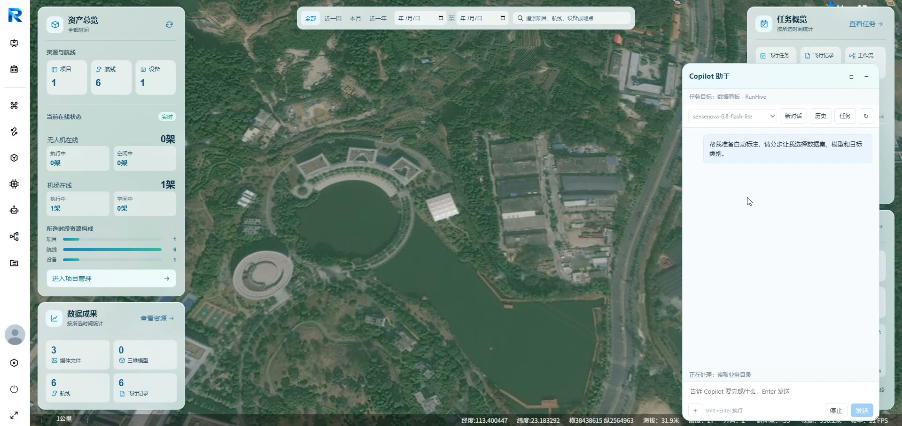
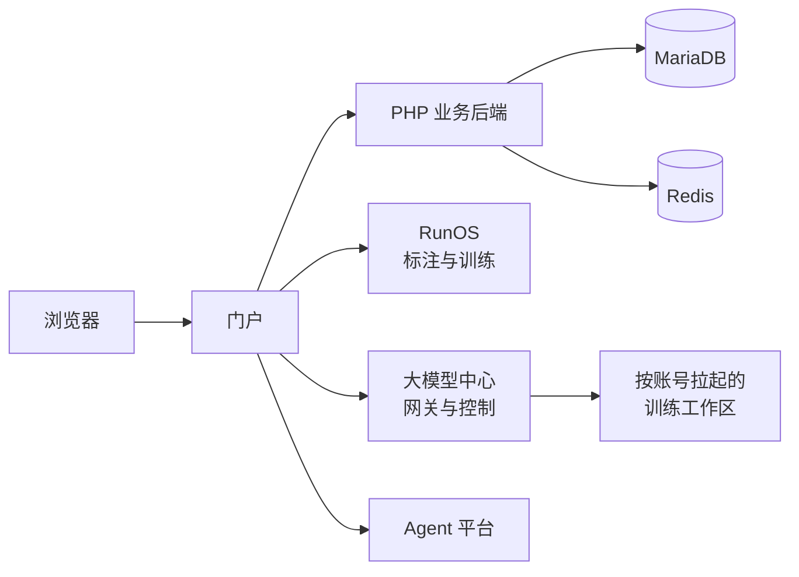
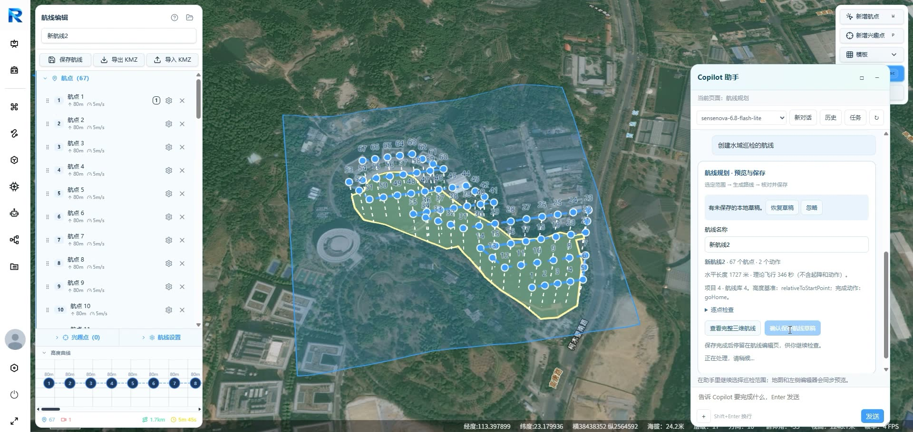
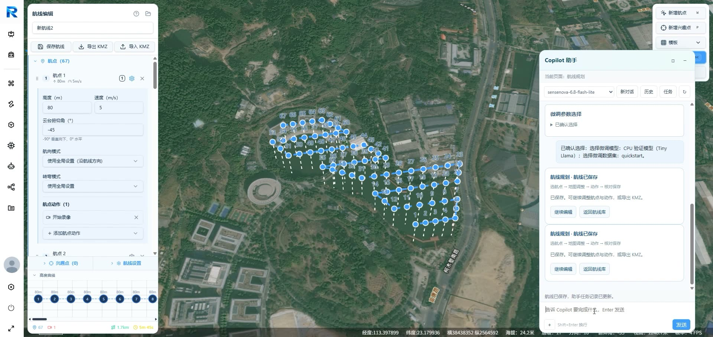
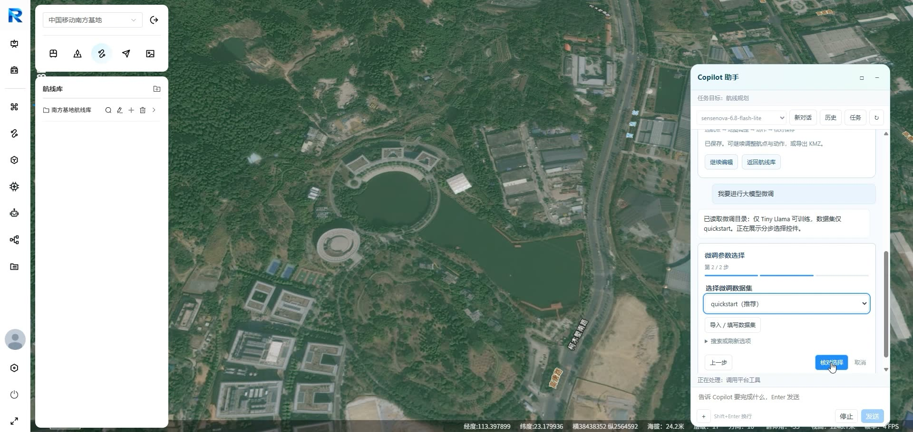
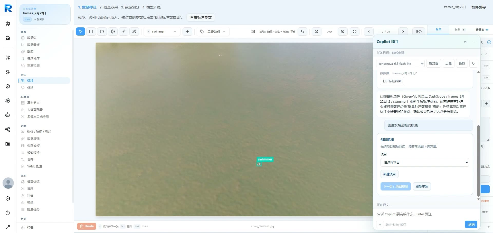
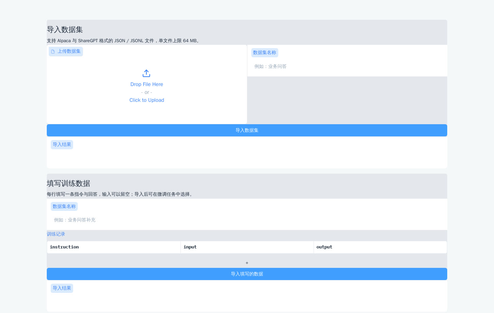
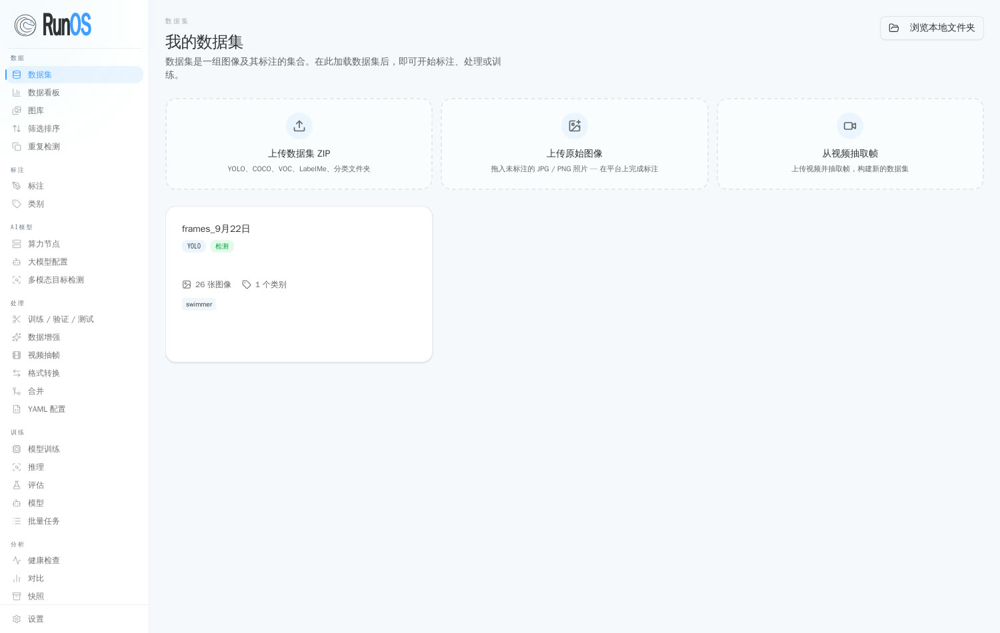

<div align="center">

# RunHive

**为无人机集群运营而生的 AI 原生平台 —— 一个内置的 Agent 助手，陪你标注数据、规划航线、微调大模型，全部在一个控制台里完成。**

可自托管 · 一条命令跑起来 · MIT 开源协议

[English](README.en.md) · [简体中文](README.md)

[](LICENSE)
[](https://github.com/melba818/RunHive-Drone-Platform/releases)
[](https://github.com/melba818/RunHive-Drone-Platform/stargazers)

</div>

RunHive 是一个面向无人机集群全流程运营的开源平台：规划任务、管理飞机与机场、执行飞行、把飞行影像变成标注数据集、训练模型、微调大模型 —— 全部在一个门户里完成。内置的 **Copilot 智能助手**坐在每一个工作台里，用对话直接操作平台，多步骤工作变成一句话加几次确认。

## 🎬 先看演示

点击下方海报播放 2 分 40 秒的产品演示 —— 这是一段真实操作录像：内置的 **Copilot 智能助手**全程用对话驱动完整工作流：AI 辅助标注 → Agent 航线规划 → 大模型微调。

[](docs/media/runhive-demo.mp4)

▶ 仓库内视频：[docs/media/runhive-demo.mp4](docs/media/runhive-demo.mp4) · 高清原版：[Google Drive](https://drive.google.com/file/d/1WXHunPKn8j_smbo4kIC76s3jNx_MgLMx/view?usp=drive_link)

## ✨ 核心能力

- **🤖 一个真正能“干活”的 Copilot 智能助手** —— 它不只是聊天。它会调用平台工具，用分步引导卡片带你完成多步骤任务，全程留痕、每一步由你确认。对它说一句“帮我准备自动标注”“给这片水域创建一条巡检航线”“我要进行大模型微调”，它就会替你驱动 RunOS、航线规划器和大模型中心。
- **🗺️ Agent 航线规划** —— 说清任务，航线自动生成。演示中一句话就生成了一条覆盖湖面的 **67 个航点、1.7 公里**测绘航线 —— 每个航点可设高度、速度、云台俯仰与动作（如开始录像），带高度曲线剖面与三维预览，一键保存进航线库，并支持 KMZ 导入/导出，无缝衔接 DJI 工作流。
- **🏷️ RunOS —— 数据引擎** —— 数据集管理、AI 辅助批量标注（视觉语言模型先标、人工复核）、质检、训练/验证集划分、YOLO 训练与推理、模型管理、可视化目标跟踪模块。飞行影像进去，可部署的模型出来。
- **🧠 大模型中心 —— 微调全程引导** —— 选一个基座模型和数据集（或用 ShareGPT / Alpaca / 纯文本格式导入自己的数据），在可视化工作台里发起微调，不用翻 YAML。Copilot 也可以用对话一步步带你走完同一流程。模型服务商密钥自备，仓库里不含任何真实密钥。
- **🚁 集群与飞行运营** —— 项目、飞机与机场管理、飞行任务与带 OSD 轨迹的飞行记录、媒体库、健康（HMS）告警、DJI 生态集成 —— 全部包在一个带角色权限的门户里。
- **🧑‍💻 Agent 平台** —— 多智能体工作台（对话、工具、MCP 桥接、机器接入），基于 [PenguinHarness](https://github.com/Prism-Shadow/penguin-harness) 构建，见 `NOTICE`。

## 🧩 架构



- **门户与 PHP 业务后端**（`services/php`）—— 账号、项目、飞行任务与业务接口，其他模块都以此为集成点。
- **RunOS**（`apps/runos-web`、`services/runos-api`）—— 数据集管理、标注流程、质检、模型训练/推理、可视化跟踪。
- **Agent 平台**（`apps/agent-web`、`services/agent-platform`）—— 多智能体工作台（对话、工具、MCP 桥接、机器接入）。
- **大模型中心**（`services/llm-center`、`apps/llm-center-web`）—— 网关、特权运行时控制器与 PHP 集成，为平台拉起大模型实例、微调任务与推理。
- **助手与工作台外壳**（`apps/assistant-web`、`apps/workbench-web`）。

## 📸 界面一览

| | |
|---|---|
|  |  |
| **资产总览** —— 机队、航线与数据成果都在实时地图上，右侧是 Copilot | **Agent 航线规划** —— 说清任务，航线自动生成 |
|  |  |
| **航线编辑器** —— 每个航点的高度 / 速度 / 云台 / 动作，高度曲线 | **大模型微调** —— “我要微调一个模型”，助手带你走完向导 |
|  |  |
| **AI 标注** —— 视觉语言模型批量预标注、人工复核 | **大模型中心** —— 数据集导入与训练工作区 |
|  |  |
| **RunOS 数据集** —— 浏览、标注、训练 | **一个门户**，管整个机队 |

## 🚀 快速开始

**只想先试试？** 克隆仓库，一条命令跑起门户演示：

```bash
git clone https://github.com/melba818/RunHive-Drone-Platform.git
cd runhive/quickstart && docker compose up -d
```

然后打开 <http://localhost:1819/>，用 `admin` / `runhive-demo` 登录。演示基于已脱敏的演示数据库，零配置即开即用。

**想要演示视频里的完整形态 —— RunOS、大模型中心、Agent 平台全套？** 在同一个 `quickstart/` 目录里改跑：

```bash
./start-full.sh
```

端口与细节见：[quickstart/README.md](quickstart/README.md)。

**从源码构建（开发用）：**

1. 克隆本仓库。
2. 从 `deploy/env/` 与各模块的示例 env 文件复制环境模板，按自己的环境填值。
3. 按模块安装依赖（PHP 后端用 Composer、前端用 pnpm/npm、Python 服务用 pip）。
4. 按各模块 README 与 `docs/MODULES.md` 里的构建与运行命令操作。

## 🗂️ 项目结构

```
runhive/
├── apps/            # 前端：门户外壳、RunOS、大模型中心、Agent 工作台
├── services/        # 后端：PHP 业务后端、RunOS API、大模型中心、Agent 平台
├── quickstart/      # 一键演示：基础门户，另有完整版（start-full.sh）
├── deploy/          # 环境模板与部署文件
├── docs/            # 模块指南、源码缺口说明、演示媒体
├── NOTICE           # 第三方代码归属
└── LICENSE          # MIT
```

## ❓ 常见问题

**需要 GPU 吗？**
演示不需要：门户、RunOS 浏览/标注、Agent 工作台都能跑在 CPU 上。大模型中心工作区里的真实训练需要 GPU 与模型权重，不在一键演示范围内，需自备。

**模型服务商密钥填在哪？**
填 `quickstart/.env`（见 `.env.example`）。AI 功能运行时用你的密钥调用服务商；不填也能正常启动，只是 AI 调用会提示未配置模型。仓库本身不含任何真实密钥。

**仓库里有真实密钥吗？**
没有。服务间密钥在首次启动时本地生成到 git 忽略的目录里，演示账号（`admin` / `runhive-demo`）是公开设计的演示账号，背后没有任何真实数据。

**有哪些内容不在里面？**
门户的可编辑前端源码不在本仓库 —— 只随包发布了构建产物。这一点已如实写在 [docs/SOURCE-GAPS.md](docs/SOURCE-GAPS.md) 里，其他已知缺口也在同一文档中。

**可以只跑门户，不跑 RunOS 和大模型中心吗？**
可以 —— 基础版一键演示（`docker compose up -d`）就是只跑门户。之后随时可以用 `./start-full.sh` 加上完整平台。

## 📚 文档

- [quickstart/README.md](quickstart/README.md) —— 演示搭建、完整版搭建、端口、排障
- [docs/MODULES.md](docs/MODULES.md) —— 各模块指南
- [docs/SOURCE-GAPS.md](docs/SOURCE-GAPS.md) —— 已知缺口与未包含内容
- [NOTICE](NOTICE) —— 第三方代码归属
- [CONTRIBUTING.md](CONTRIBUTING.md) —— 如何参与贡献
- [SECURITY.md](SECURITY.md) —— 安全问题上报方式

## 📄 许可证与第三方代码

RunHive 自有代码以 **MIT 协议**发布 —— 见 [LICENSE](LICENSE)。

本仓库还包含或集成了第三方组件，遵循各自的协议（包括 Apache-2.0 组件、GPL-3.0 血统的跟踪代码、OFL-1.1 字体）。再发布前请先看 [NOTICE](NOTICE) 里的完整归属清单。

## 🤝 参与贡献 · 安全

见 [CONTRIBUTING.md](CONTRIBUTING.md)。安全问题上报：见 [SECURITY.md](SECURITY.md)。
