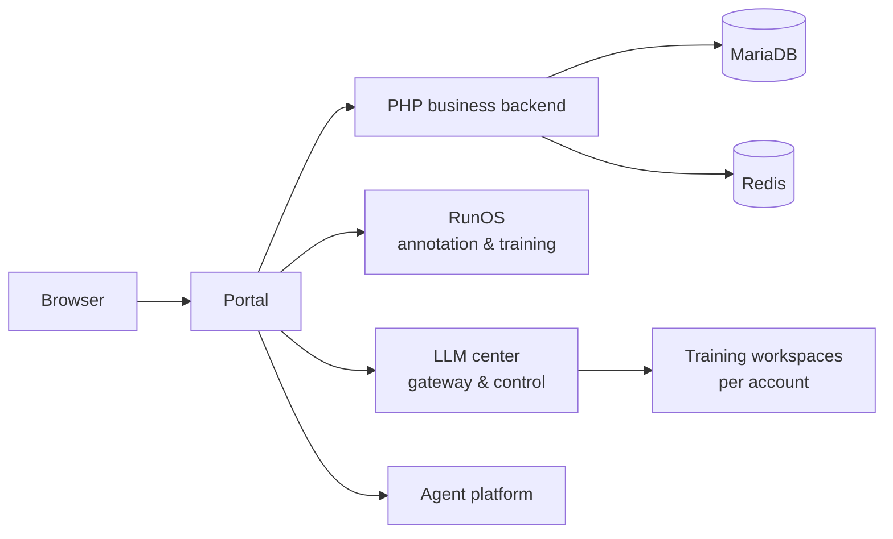

<div align="center">

# RunHive

**The AI-native drone fleet platform — one portal for flight operations, data annotation, model training, and LLM fine-tuning, driven by a Copilot agent that does the work with you.**

Self-hosted · One command to run · MIT licensed

[English](README.md) · [简体中文](README.zh-CN.md)

[](LICENSE)
[](https://github.com/melba818/RunHive-Drone-Platform/releases)
[](https://github.com/melba818/RunHive-Drone-Platform/stargazers)

</div>

RunHive is an open-source platform for operating a drone fleet end to end: plan missions, manage aircraft and docks, fly tasks, turn flight imagery into labeled datasets, train models, and fine-tune large models — all from one portal. A built-in **Copilot agent** sits in every workspace and operates the platform through conversation, so multi-step work becomes a sentence followed by confirmations.

## 🎬 Watch it in action

Click the poster to play the 2:40 product tour — a real session where the built-in **Copilot agent** drives the whole workflow by conversation: AI-assisted annotation → agent route planning → LLM fine-tuning.

[](docs/media/runhive-demo.mp4)

▶ In-repo video: [docs/media/runhive-demo.mp4](docs/media/runhive-demo.mp4) · Full-quality original: [Google Drive](https://drive.google.com/file/d/1WXHunPKn8j_smbo4kIC76s3jNx_MgLMx/view?usp=drive_link)

## ✨ Key capabilities

- **🤖 A Copilot agent that actually operates the platform** — it doesn't just chat. It calls platform tools, walks you through multi-step tasks with guided cards, and keeps a task ledger while you confirm each step. Ask it to *"prepare auto-annotation"*, *"create a patrol route for this water area"*, or *"start a fine-tuning run"*, and it drives RunOS, the route planner, and the LLM center for you.
- **🗺️ Agent route planning** — describe the mission; the agent generates the route. In the demo, one sentence produces a **67-waypoint, 1.7 km survey route** over a lake — with per-waypoint altitude, speed, gimbal pitch and actions (e.g. start recording), a height profile, 3D preview, one-click save to the route library, and KMZ import/export for DJI workflows.
- **🏷️ RunOS — the data engine** — datasets, AI-assisted batch annotation (vision-language models pre-label, humans review), quality control, train/val splits, YOLO training & inference, model management, and a visual object-tracking module. Flight imagery goes in; deployable models come out.
- **🧠 LLM center — fine-tuning, guided end to end** — pick a base model and a dataset (or import your own in ShareGPT / Alpaca / plain-text formats), and launch fine-tuning from a visual workspace — no YAML spelunking required. The Copilot can drive the same flow conversationally, step by step. Bring your own provider key; the repository contains no real keys.
- **🚁 Fleet & flight operations** — projects, aircraft and dock management, flight tasks and records with OSD tracks, a media library, health (HMS) alerts, and DJI ecosystem integration — everything wrapped in one portal with role-based access control.
- **🧑‍💻 Agent platform** — a multi-agent workbench (chat, tools, MCP bridges, machine access) built on [PenguinHarness](https://github.com/Prism-Shadow/penguin-harness); see `NOTICE`.

## 🧩 Architecture



- **Portal & PHP business backend** (`services/php`) — accounts, projects, flight-task and business APIs that everything else integrates with.
- **RunOS** (`apps/runos-web`, `services/runos-api`) — dataset management, annotation workflows, quality review, model training/inference, visual tracking.
- **Agent platform** (`apps/agent-web`, `services/agent-platform`) — multi-agent workbench (chat, tools, MCP bridges, machine access).
- **LLM center** (`services/llm-center`, `apps/llm-center-web`) — gateway, privileged runtime controller and PHP integration brokering LLM instances, fine-tuning jobs and inference for the platform.
- **Assistant & workbench shells** (`apps/assistant-web`, `apps/workbench-web`).

## 📸 Screenshots

| | |
|---|---|
|  |  |
| **Asset overview** — fleet, routes and data results on a live map, Copilot on the right | **Agent route planning** — describe the mission, get a survey route |
|  |  |
| **Route editor** — per-waypoint altitude / speed / gimbal / actions, height profile | **LLM fine-tuning** — "I want to fine-tune a model", the agent runs the wizard |
|  |  |
| **AI annotation** — VLM batch pre-labeling with human review in RunOS | **LLM center** — dataset import and training workspaces |
|  |  |
| **RunOS datasets** — browse, annotate, train | **One portal** for the whole fleet |

## 🚀 Quick start

**Just want to try it?** Clone this repo and run one command for the portal demo:

```bash
git clone https://github.com/melba818/RunHive-Drone-Platform.git
cd runhive/quickstart && docker compose up -d
```

Then open <http://localhost:1819/> and log in with `admin` / `runhive-demo`. The quickstart boots the full portal experience against a sanitized demo database, no configuration needed.

**Want the complete platform from the demo video — RunOS, the LLM center and the Agent platform included?** Run this in the same `quickstart/` directory instead:

```bash
./start-full.sh
```

Details, ports and options: [quickstart/README.md](quickstart/README.md).

**Building from source (development):**

1. Clone this repository.
2. Copy the environment templates from `deploy/env/` and each module's example env file; fill in values for your environment.
3. Install dependencies per module (Composer for the PHP backend, pnpm/npm for the web apps, pip for the Python services).
4. Follow the per-module README and `docs/MODULES.md` for build and run commands.

## 🗂️ Project structure

```
runhive/
├── apps/            # Web frontends: portal shells, RunOS, LLM center, agent workbench
├── services/        # Backends: PHP business backend, RunOS API, LLM center, agent platform
├── quickstart/      # One-command demo: base portal, plus the full platform (start-full.sh)
├── deploy/          # Environment templates and deployment files
├── docs/            # Module guide, source-gap notes, demo media
├── NOTICE           # Third-party attribution
└── LICENSE          # MIT
```

## ❓ FAQ

**Do I need a GPU?**
Not for the demo: the portal, RunOS browsing/annotation and the agent workbench run on CPU. Real model training inside the LLM-center workspaces needs a GPU and model weights, which are outside the one-command demo — bring your own.

**Where do I put my model provider key?**
In `quickstart/.env` (see `.env.example`). AI features call the provider at runtime with your key; without it the platform still runs, but AI calls report that no model is configured. The repository itself contains no real keys.

**Are there real secrets in this repo?**
No. Inter-service secrets are generated fresh on first start into git-ignored directories, and the demo login (`admin` / `runhive-demo`) is public by design with no real data behind it.

**What is not included?**
The portal's editable frontend source is not in this repository — only its built distribution is shipped. This is documented honestly in [docs/SOURCE-GAPS.md](docs/SOURCE-GAPS.md), along with the other known gaps.

**Can I run only the portal, without RunOS and the LLM center?**
Yes — that is exactly what the base quickstart (`docker compose up -d`) does. Add the full platform later with `./start-full.sh`.

## 📚 Documentation

- [quickstart/README.md](quickstart/README.md) — demo setup, full-platform setup, ports, troubleshooting
- [docs/MODULES.md](docs/MODULES.md) — per-module guide
- [docs/SOURCE-GAPS.md](docs/SOURCE-GAPS.md) — known gaps and what is not included
- [NOTICE](NOTICE) — third-party attribution
- [CONTRIBUTING.md](CONTRIBUTING.md) — how to contribute
- [SECURITY.md](SECURITY.md) — how to report security issues

## 📄 License & third-party code

RunHive's own code is released under the **MIT License** — see [LICENSE](LICENSE).

This repository also contains or integrates third-party components under their own licenses (including Apache-2.0 components, GPL-3.0-lineage vendored tracking code, and OFL-1.1 fonts). See [NOTICE](NOTICE) for the full attribution list before redistributing.

## 🤝 Contributing · Security

See [CONTRIBUTING.md](CONTRIBUTING.md). Security reports: see [SECURITY.md](SECURITY.md).
